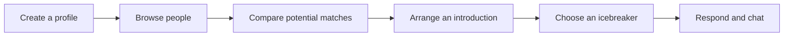
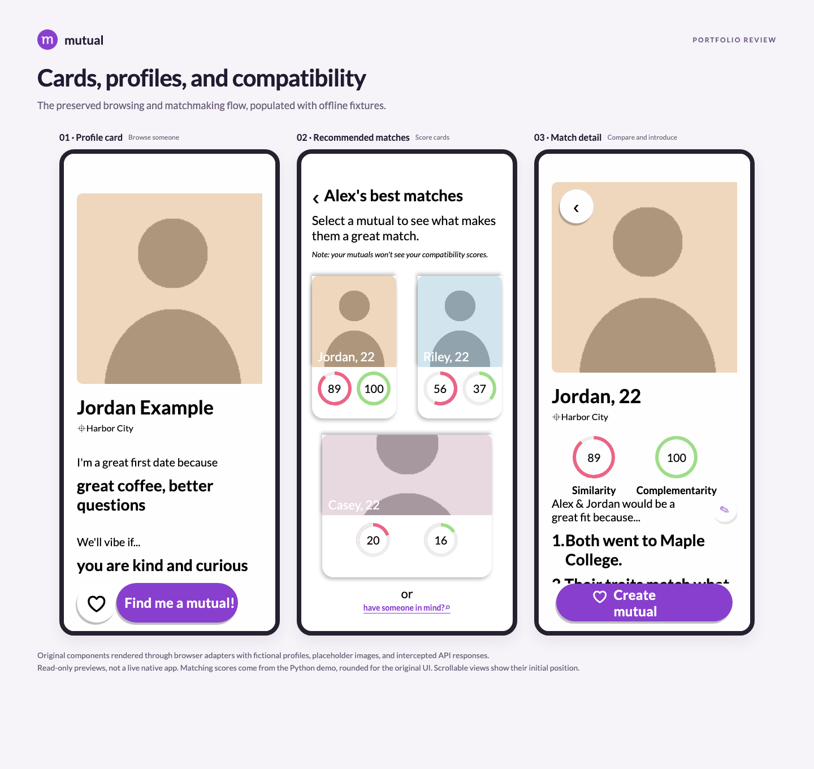
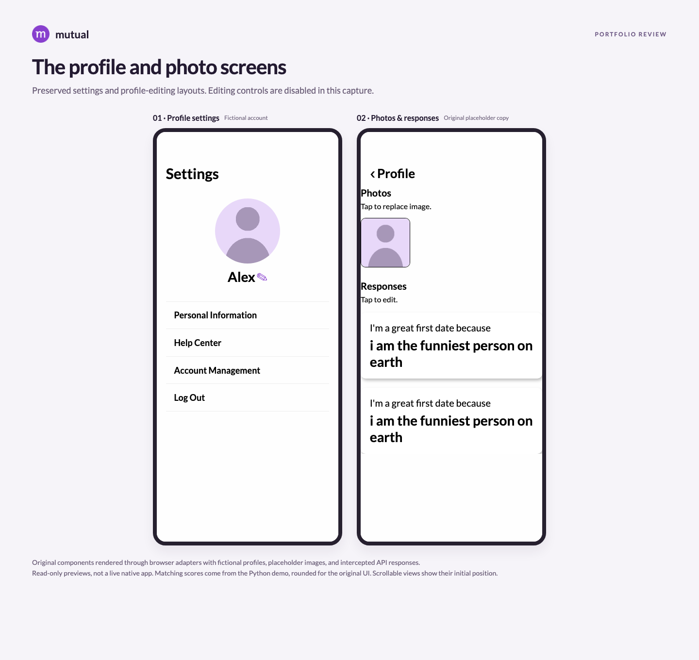
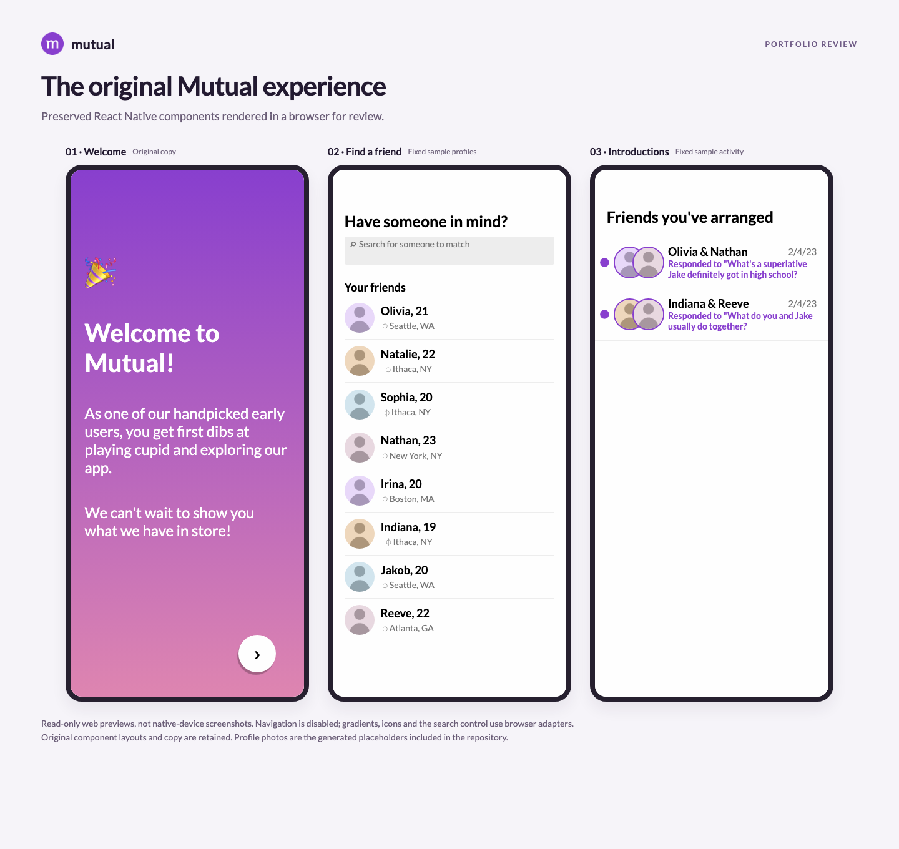
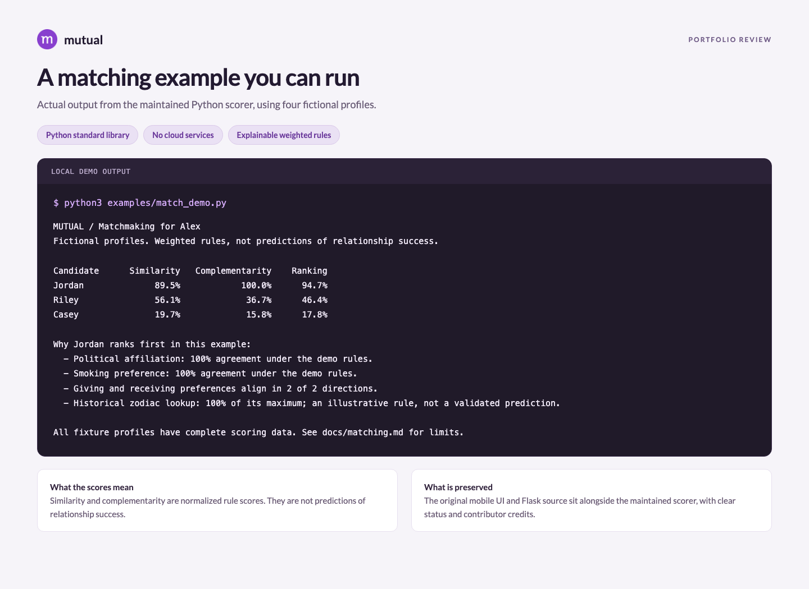

# Mutual

**A matchmaking prototype where friends make the introduction.**

Mutual explored a different role for dating apps: helping someone introduce two people they know. A matchmaker browses profiles, compares similarity and complementarity, and chooses a question to help the pair start talking.

This repository preserves the original 2023 React Native application and Flask backend, alongside a runnable, dependency-free version of the matching engine. It is a portfolio edition of a collaborative prototype. The mobile app and API remain historical source; the supported runnable experience is the Python example below.

## Try the matching example

Requires **Python 3.10 or newer**. From the repository root:

```sh
python3 examples/match_demo.py
```

No package installation, database, account, credentials, or network connection is needed. On Windows, `py -3` can be used in place of `python3`.

```text
Candidate      Similarity   Complementarity    Ranking
Jordan              89.5%            100.0%      94.7%
Riley               56.1%             36.7%      46.4%
Casey               19.7%             15.8%      17.8%
```

The example compares Alex with three fictional profiles and explains the strongest factors. These are weighted rule scores, **not probabilities of relationship success**. The original personality-type and zodiac tables are retained as documented, optional heuristics.

For every contribution and the amount of comparable data:

```sh
python3 examples/match_demo.py --json
```

[Read the scoring rules](docs/matching.md) · [See the fictional profiles](examples/profiles.json) · [See full example output](examples/output.txt)

## The original experience



This is the intended product journey. Some transitions were not completed in the prototype.

| Area | What is preserved | Status in this edition |
| --- | --- | --- |
| Onboarding and profiles | Questionnaire, preferences, profile cards, photo UI | Historical mobile source; some edit screens are stubs |
| Discovery and introductions | Browsing, comparison cards, reasons, prompt selection | Historical source; search and some lists use fixtures |
| Matching | Similarity, complementarity, weighted factors, explanations | Runnable Python package with regression tests |
| Messaging | Chat UI, conversation/message models, Socket.IO handlers | Historical source; authorization and introduction-to-chat integration unfinished |
| Branding | Purple palette, logo, splash artwork, Lato typography | Preserved; portrait photos replaced with generated placeholders |

## Review screenshots

The preserved components rendered in a browser with fictional profiles and offline data. These are read-only web previews with native-service adapters, not screenshots of a working native app.

Profile cards, recommended matches, and the detailed compatibility view:



Profile settings, photos, and prompt responses:



Welcome, friend search, and introductions:



Actual output from the runnable Python example, displayed in a review page:



[Screenshot provenance and reproduction instructions](docs/screenshots/README.md)

## Explore the source

```text
backend/
  matching/         Maintained Python scorer; no third-party dependencies
  prototype/        Sanitized historical Flask API, models, and original algorithm
frontend/           Preserved React Native screens, components, assets, native scaffolding
examples/           Fictional profiles and a runnable comparison
tests/              Matching behavior and demo checks
docs/               Architecture, scoring rules, feature status, and provenance
scripts/            Repository checks and reproducible placeholder assets
```

- [Architecture and code map](docs/architecture.md)
- [Feature status and boundaries](docs/status.md)
- [Mobile source notes](frontend/README.md)
- [Historical API notes](backend/prototype/README.md)
- [Preservation decisions and source history](docs/provenance.md)

## Verify locally

```sh
python3 -m unittest discover -s tests -v
python3 scripts/check_repository.py
```

The tests cover neutral-answer agreement, ordinal distance, categorical comparisons, missing data, reciprocal preferences, symmetric scores, invalid input, and the CLI. Repository checks inspect Python/JSON syntax, local JavaScript imports, documentation links, and selected credential patterns. They are not a full security audit or a native application build.

A [GitHub Actions workflow](.github/workflows/checks.yml) runs the supported checks on Python 3.10 and 3.13 after publication. Local verification details are recorded in [the status document](docs/status.md).

## Project history and credits

The original project was built collaboratively by **Somil Aggarwal and Nalu Concepcion**. This edition consolidates their original frontend and backend repositories and adds a maintained matching example, corrected scoring behavior, tests, and project documentation.

[Contributor and licensing notes](NOTICE.md) · [Asset provenance](docs/assets.md)
