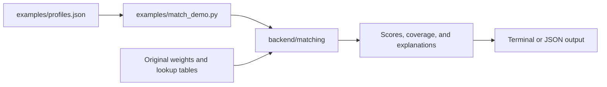
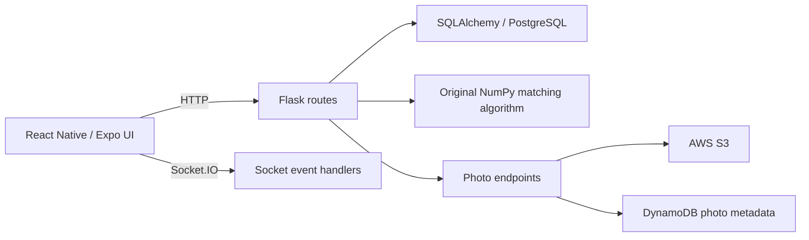

# Architecture

Mutual consists of a preserved product prototype and a small maintained example. They share the matching concept but have separate execution paths.

## Supported execution path

The CLI resolves its fixture path relative to its own file, so it can run from another working directory. The scorer uses only Python's standard library and loads data relative to its module. It does not import the Flask application, open sockets, write profiles, or access cloud storage.

`score_profiles(left, right, weights=...)` returns immutable score records. Each group contains its value, comparable-data coverage, and individual contributions. Reasons are derived from the same contributions used to calculate the score.

## Original prototype

This diagram describes the historical design, not services provisioned by this repository. No database, cloud account, or live API is included. The maintained scorer is not wired into the historical API: doing so would require an explicit API contract migration because score semantics changed.

| Concept | Source |
| --- | --- |
| Navigation and providers | [frontend/App.js](../frontend/App.js) |
| Profile browsing | [Source.js](../frontend/src/screens/Source/Source.js) |
| Match comparison | [Arrange2.js](../frontend/src/screens/Arrange/Arrange2.js) |
| Icebreaker selection | [MatchPrompts.js](../frontend/src/screens/Arrange/MatchPrompts.js) |
| Chat interface | [Conversation.js](../frontend/src/screens/Chat/Conversation.js) |
| Historical HTTP routes | [routes.py](../backend/prototype/app/routes.py) |
| Historical socket events | [socket_events.py](../backend/prototype/app/socket_events.py) |
| Original domain models | [models](../backend/prototype/app/models) |
| Maintained scorer | [scoring.py](../backend/matching/scoring.py) |

The original models cover accounts, profiles, friendships, interactions, arrangements, conversations, messages, and photos. Account and profile identity are not consistently linked, and many relationship constraints were never implemented. The only saved migration creates an unrelated `cars` table; it cannot reconstruct the app schema.

## Deliberate boundaries

This edition demonstrates source design and matching behavior. It does not add a new frontend, provision the original cloud services, repair the full authentication system, or claim a working native release. The next work required for those outcomes is listed in [status](status.md).
